  

  
  
  

  

  

<h2 align="center">🛠️ What I build with</h2>

<b>FRONTEND</b> 
  

<b>BACKEND</b> 
  

<b>AI</b> 
  
  
  
  
  

<h2 align="center">🌊 Activity in the pond</h2>

  

  <picture>
    <source media="(prefers-color-scheme: dark)" srcset="https://raw.githubusercontent.com/zimpele/zimpele/output/snake-dark.svg" />
    <source media="(prefers-color-scheme: light)" srcset="https://raw.githubusercontent.com/zimpele/zimpele/output/snake-light.svg" />
    
  </picture>

  

