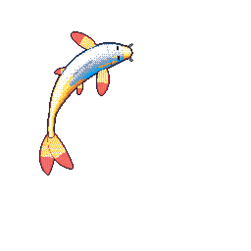

  

  
  
  

 

  

 

<h2 align="center">🎏 Meet my koi</h2>

<table align="center">
  <tr>
    <td align="center" width="300">
      
    </td>
    <td width="420">
      <b>This fish is alive.</b> Every night at midnight UTC a GitHub Action redraws it from my activity:
        
      🎨 &nbsp;<b>Languages</b> paint its scales 
      📈 &nbsp;<b>Contributions</b> make it grow 
      🔥 &nbsp;<b>Streaks</b> leave their marks 
      🌊 &nbsp;<b>Yesterday</b> decides how it swims
        
      Powered by <a href="https://github.com/yalongwastaken/git-koi">git-koi</a> · body: <code>gold</code>
    </td>
  </tr>
</table>

<h2 align="center">🛠️ What I build with</h2>

<b>FRONTEND</b> 
  

<b>BACKEND</b> 
  

<b>AI</b> 
  
  
  
  
  

<h2 align="center">🌊 Activity in the pond</h2>

  

  <picture>
    <source media="(prefers-color-scheme: dark)" srcset="https://raw.githubusercontent.com/zimpele/zimpele/output/snake-dark.svg" />
    <source media="(prefers-color-scheme: light)" srcset="https://raw.githubusercontent.com/zimpele/zimpele/output/snake-light.svg" />
    
  </picture>

  

